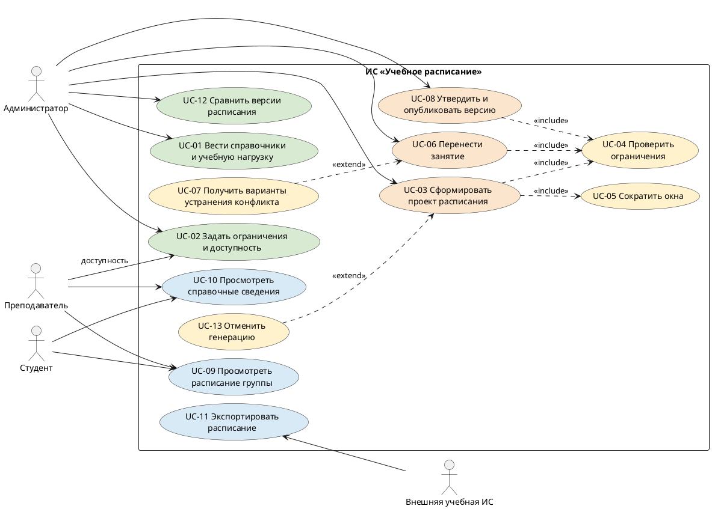

# Диаграмма прецедентов

Диаграмма задаёт функциональную границу системы: четыре актёра, тринадцать прецедентов, отношения include и extend и рамку системы. Центральные результаты для администратора — сформировать проект расписания, безопасно перенести занятие и опубликовать проверенную версию. Студент и преподаватель получают опубликованное расписание и справочные сведения.

## Покрытие

БТ-01…БТ-03, ПТ-01…ПТ-11, СХ-05, О-01.

## Допущения

Актёры совпадают с внешними сущностями DFD и контекстной диаграммы IDEF0 работы № 2: администратор, преподаватель, студент. Внешняя учебная ИС — актёр интеграции, введённый в этой работе. Преподаватель расписание не утверждает, а только сообщает доступность. Выбор языка интерфейса (ПТ-09) — настройка веб-интерфейса, а не отдельный прецедент.

## Диаграмма

