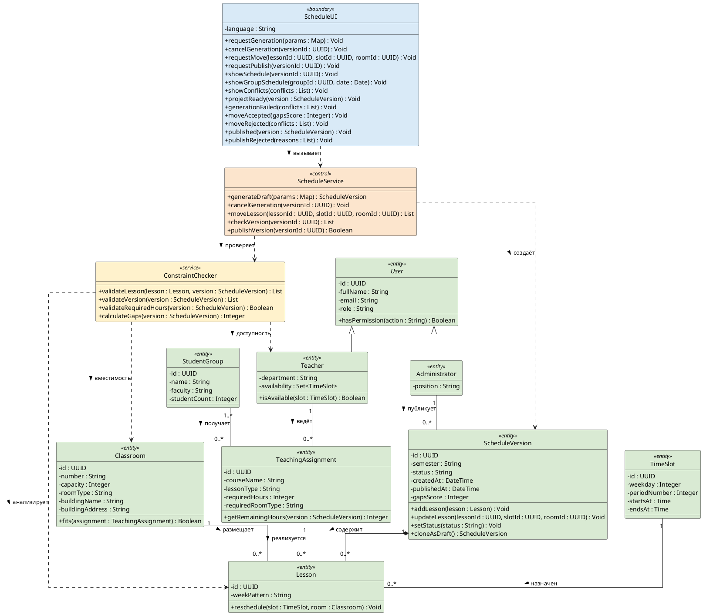

# Диаграмма классов

Диаграмма уточняет информационную модель IDEF1 работы № 2: у сущностей появляются операции, а над ними — граничный, управляющий и сервисный классы. Двенадцать классов размечены стереотипами entity, boundary, control и service. Композиция ScheduleVersion–Lesson показывает, что занятие принадлежит одной версии расписания. Administrator и Teacher наследуются от User: оба входят в систему и получают права по роли.

## Покрытие

ПТ-01…ПТ-09, ПТ-11, СХ-06, О-01, О-04…О-07.

## Допущения

Дисциплина отражена атрибутом courseName класса TeachingAssignment, учебный корпус — атрибутами buildingName и buildingAddress класса Classroom: отдельные классы Course и Building не введены, чтобы модель осталась в пределах двенадцати классов. Студент смотрит публичное расписание без входа, поэтому отдельного класса пользователя-студента нет. StudentGroup и TimeSlot операций не имеют: пересечения и окна считает ConstraintChecker.

## Диаграмма

