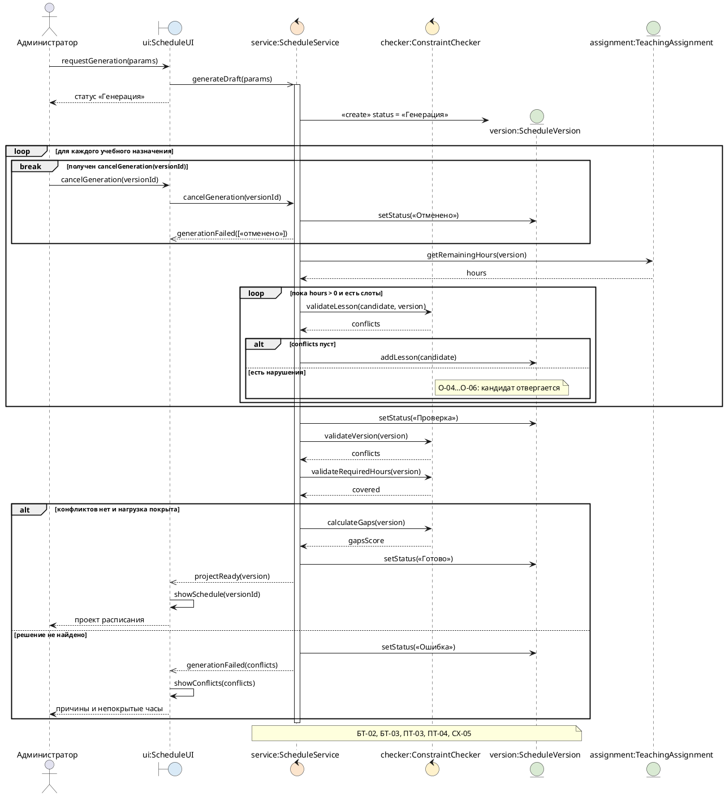

# Последовательность: генерация расписания

Диаграмма раскрывает прецедент UC-03. Генерация запускается асинхронно: веб-интерфейс сразу возвращает управление администратору, а результат приходит обратным сообщением. Внутри расчёта показаны подбор слота и аудитории для каждого учебного назначения, проверка отдельного занятия, повторная проверка всей версии и подсчёт окон. Фрагмент break прерывает расчёт по запросу отмены (UC-13).

## Покрытие

UC-03, UC-13; БТ-02, БТ-03; ПТ-03, ПТ-04; СХ-05; О-04…О-06; КП-01…КП-03, КП-06.

## Допущения

Операция generateDraft() представляет алгоритм планирования одним сервисом. Перебор вариантов и эвристика оптимизации до уровня кода не детализируются.

## Диаграмма

