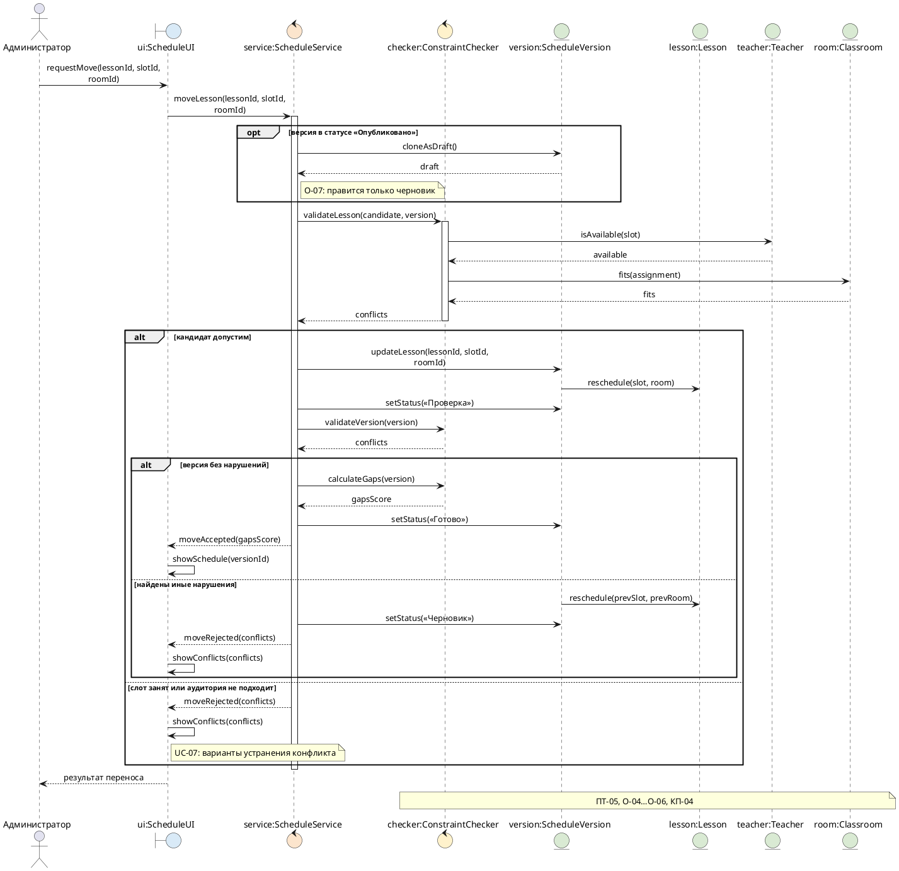

# Последовательность: перенос занятия

Диаграмма раскрывает прецедент UC-06. Проверка двухступенчатая: сначала проверяется кандидат — доступность преподавателя, вместимость и тип аудитории, занятость слота, — затем вся версия. Опубликованную версию напрямую не правят: сервис создаёт черновик-копию. Если общая проверка не пройдена, перенос откатывается.

## Покрытие

UC-06, UC-07; ПТ-05; О-01, О-04…О-07; КП-04, КП-05.

## Допущения

Проверка и запись выполняются в одной транзакции. Блокировки базы данных на диаграмме не показаны.

## Диаграмма

