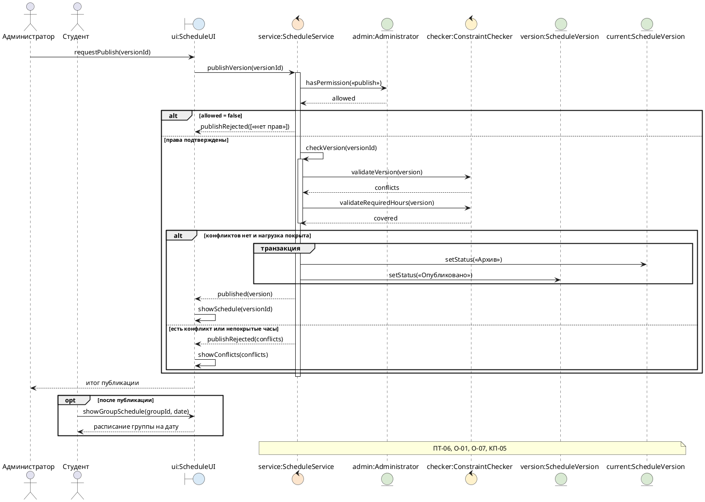

# Последовательность: публикация версии

Диаграмма раскрывает прецедент UC-08. Перед публикацией сервис проверяет право администратора, повторно проверяет конфликты и покрытие нагрузки. Смена опубликованной версии идёт одной транзакцией: прежняя версия уходит в архив, новая получает статус «Опубликовано». После публикации студент получает расписание своей группы на выбранную дату.

## Покрытие

UC-08, UC-09; БТ-01; ПТ-06, ПТ-07; СХ-06; О-01, О-07; КП-05, КП-07.

## Допущения

Право публикации проверяется операцией hasPermission(), унаследованной от User. Сбой транзакции откатывает обе смены статуса, поэтому прежняя опубликованная версия остаётся доступной.

## Диаграмма

