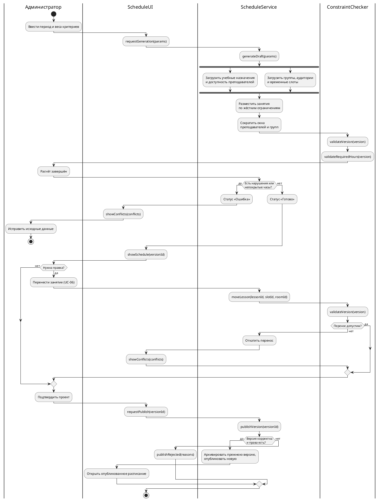

# Деятельность: формирование и публикация

Диаграмма проводит сквозной процесс от ввода параметров до публикации по дорожкам исполнителей: администратор, ScheduleUI, ScheduleService и ConstraintChecker. Загрузка учебных назначений и загрузка аудиторного фонда независимы, поэтому идут параллельно. Долгий расчёт показан сигналом ожидания: администратор ждёт событие «Расчёт завершён», а не висящее действие. Решения администратора и результаты проверок оформлены развилками.

## Покрытие

UC-03, UC-06, UC-08; ПТ-03…ПТ-06; СХ-05; О-04…О-07; КП-01…КП-05.

## Допущения

Параллельны только независимые операции чтения данных. Проверка и публикация выполняются после завершения расчёта.

## Диаграмма

