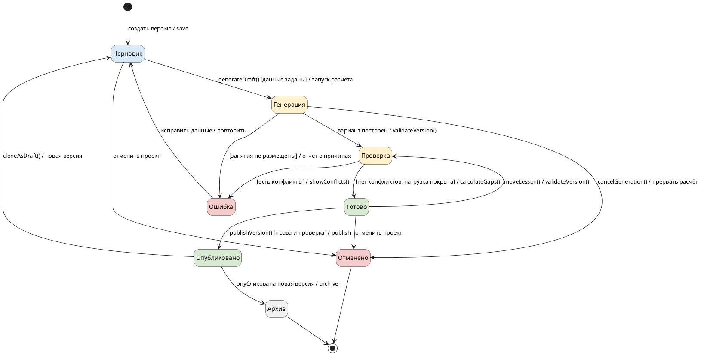

# Состояния версии расписания

Диаграмма описывает жизненный цикл ScheduleVersion — сущности с реальной динамикой. Основной путь: «Черновик → Генерация → Проверка → Готово → Опубликовано → Архив». Отдельно показаны ветки ошибки, отмены и возврата к редактированию. Каждый переход подписан в формате «событие [условие] / действие». Набор статусов совпадает с атрибутом status сущности SCHEDULE информационной модели работы № 2 и со статусами в диаграммах последовательности.

## Покрытие

ПТ-03…ПТ-06, ПТ-11; СХ-05, СХ-06; О-07; КП-04, КП-05.

## Допущения

Опубликованная версия неизменяема. Исправление создаёт новую версию в статусе «Черновик» операцией cloneAsDraft(), а прежняя версия остаётся опубликованной до замены.

## Диаграмма

