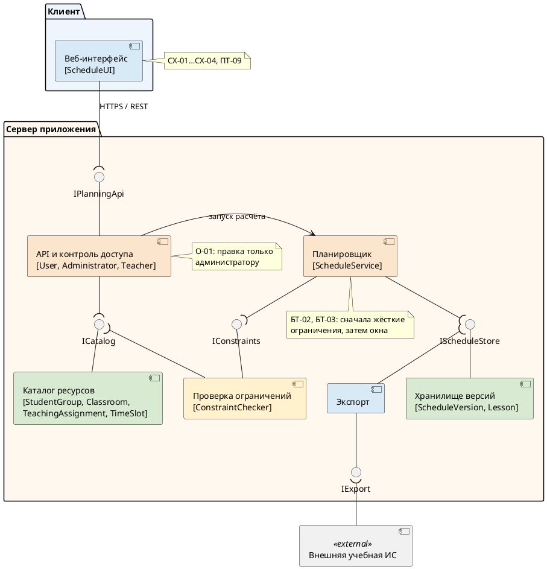

# Компоненты

Система разбита по функциональным подсистемам: веб-интерфейс, API и контроль доступа, каталог ресурсов, планировщик, проверка ограничений, хранилище версий и модуль экспорта. Контракты между ними заданы интерфейсами IPlanningApi, ICatalog, IConstraints, IScheduleStore и IExport: компонент-поставщик предоставляет интерфейс (кружок), компонент-потребитель его требует (полукруг). В квадратных скобках указаны классы диаграммы классов, которые реализует компонент.

## Покрытие

ПТ-01…ПТ-11; СХ-01…СХ-06; О-01.

## Допущения

Контракты интерфейсов концептуальны: конкретные маршруты API уточняются при реализации. Веб-интерфейс собирается на HTML5, CSS и JavaScript без серверного рендеринга страниц.

## Диаграмма

