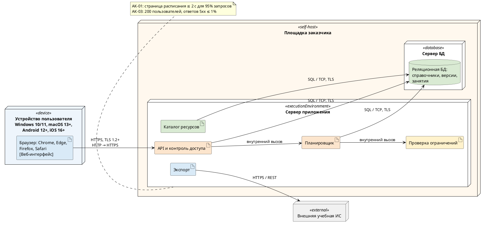

# Развёртывание

Диаграмма размещает компоненты по узлам. Устройство пользователя несёт браузер с веб-интерфейсом; на нём подписаны поддерживаемые операционные системы и браузеры из требований к платформе. Сервер приложения и сервер базы данных стоят на площадке заказчика: поставка self-host из ограничения О-03. Связи подписаны протоколами: HTTPS с TLS 1.2 и новее до сервера приложения, SQL поверх TLS до базы данных, HTTPS/REST до внешней учебной ИС.

## Покрытие

ПТ-07, ПТ-10; СХ-01…СХ-04, СХ-06; АК-01…АК-03; О-02, О-03.

## Допущения

Реляционная СУБД и размещение всех модулей на одном сервере приложения — проектные допущения, развёрнутой системой не подтверждены. Если расчёт расписания начнёт мешать отклику страниц (АК-01), планировщик выносится на отдельный узел.

## Диаграмма

