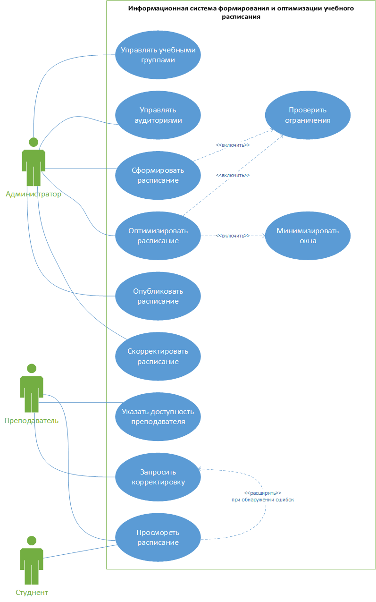

# Microsoft Visio

Microsoft Visio — редактор схем. UML в нём собран из шаблонов и наборов фигур, в том числе фигур UML 2.5. Рядом доступны ERD, блок-схемы, организационные и сетевые схемы. Основной сценарий — оформить отдельную диаграмму. Репозитория единой UML-модели в этом сценарии нет. Рассмотрены описание продукта и построенная диаграмма.

## Возможности

- Фигуры ставятся перетаскиванием, связи и подписи правятся на листе.
- Есть шаблоны диаграмм классов, вариантов использования, компонентов, последовательности и других видов UML.
- Набор фигур UML 2.5 содержит обозначения отношений.
- Сетка, направляющие, выравнивание и соединители помогают быстро получить читаемый лист.
- Схему можно сохранить в PDF, PNG, JPEG, SVG и другие графические форматы.
- Веб-версия даёт общий доступ и комментарии через сервисы Microsoft.
- Visio Plan 1 открывает UML в браузере, в том числе на macOS, без настольной установки.
- Помимо UML доступны блок-схемы, ERD, сетевые и бизнес-схемы. Plan 2 добавляет BPMN и интеграции.

## Ограничения

- Базовый Visio в Microsoft 365 не создаёт и не редактирует UML. Нужен Plan 1, Plan 2 или подходящая настольная редакция.
- Plan 1 — это веб-приложение. Настольная программа для Windows и работа без сети относятся к Plan 2.
- Листы UML остаются рисунками. Сквозной генерации кода из одной модели UML у Visio нет.
- Классы, операции и связи на разных листах приходится сверять вручную.
- В веб-редакторе Microsoft указывается девять типов UML-диаграмм. Состав зависит от редакции.
- Браузерная работа требует сети, учётной записи и лицензии.
- Совместное редактирование обычно идёт через OneDrive, SharePoint или Teams.
- PNG, SVG и PDF переносят картинку. Семантическую модель через XMI этот экспорт не заменяет.

## Диаграмма

Диаграмма вариантов использования построена в Microsoft Visio. На ней три актёра, прецеденты расписания и рамка системы. Отношения на листе подписаны по-русски: «включить» и «расширить».

## Протокол

Подпись: Протокол построения в Microsoft Visio

| Поле | Значение |
| --- | --- |
| Участник | — |
| Инструмент | Microsoft Visio, редакция с набором UML |
| Предыдущий опыт | В проекте ранее не применялся |
| Дата | Ноябрь 2026 |
| Время освоения, мин | — |
| Время построения, мин | — |
| Диаграмма достроена | Да. Три актёра, прецеденты расписания и рамка системы |
| Обращения к справке | — |
| Трудности | Отношения подписаны словами «включить» и «расширить». Лист не связан с общей моделью |
| Оценка по критерию 4 | 5. Фигуры ставятся перетаскиванием, сетка даёт читаемый лист |
| Оценка по критерию 5 | 4. Лист читается, подписи отношений не являются стереотипом UML |
| Комментарий | Для UML нужен отдельный план. Базовый Visio в Microsoft 365 диаграмму UML не создаёт |
