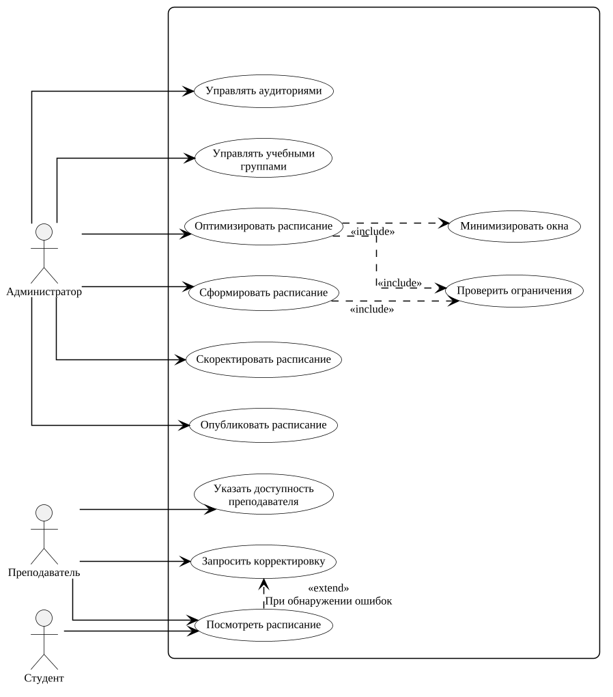

# PlantUML

PlantUML строит UML-диаграмму из текстового описания. Элементы на холсте не расставляются мышью: картинку собирает генератор. Диаграмма задаётся текстовым исходником диаграмма.puml. Для рисунка отчёта фон принят белым.

## Возможности

- Диаграмма хранится текстом, поэтому изменение видно в git.
- Раскладку считает генератор: блоки и стрелки не нужно выравнивать вручную.
- Текст диаграммы встраивается в Markdown, LaTeX и вики. Сервер PlantUML можно поднять у себя, в том числе в Docker, и не отправлять описание на чужой хост.
- Продукт бесплатный. Основная поставка распространяется под GPL-3.0, тот же код доступен также под LGPL и другими свободными лицензиями. Покупать лицензию для учебной работы не нужно.
- Для диаграмм классов, последовательности и прецедентов синтаксис короткий.
- Диаграмма сущность–связь строится элементами entity. Информационная модель работы № 2 собрана этим способом.
- Диаграммы хорошо генерируются с помощью ИИ.
- В большинстве редакторов есть плагины, которые помогают работать с PlantUML.
- Диаграмму можно экспортировать в изображение: PNG, SVG и PDF.

## Ограничения

- Точное положение стрелки или блока задать трудно. На построенной диаграмме подпись одного include садится на линию.
- Синтаксис не является сертифицированной нотацией OMG и местами отходит от спецификации.
- Отдельного холста с перетаскиванием нет. Вся правка идёт в тексте.
- Часть видов диаграмм требует Graphviz. Без него или со старой версией генерация останавливается.
- Сообщение об ошибке часто не указывает строку. В длинном файле причину приходится искать перебором.
- Генерации кода и обмена XMI нет.
- У экспорта с прозрачным фоном линии актёров чёрные, поэтому на тёмной подложке актёры пропадают. Для отчёта использован рисунок с белым фоном.

## Диаграмма

Исходник описывает администратора, преподавателя и студента, прецеденты расписания, include, extend и рамку системы. Имя рамки в тексте не задано, на рисунке она есть.



## Протокол

Подпись: Протокол построения в PlantUML 1.2026.8

| Поле | Значение |
| --- | --- |
| Участник | Дутов Д. В. |
| Инструмент | PlantUML 1.2026.8 |
| Предыдущий опыт | Применяется в работе на постоянной основе |
| Дата | Ноябрь 2026 |
| Время освоения, мин | 0 |
| Время построения, мин | 20 |
| Диаграмма достроена | Да. Три актёра, прецеденты расписания, include, extend и рамка системы |
| Обращения к справке | Да. Чтобы задать стили для лучшего отображения |
| Трудности | Подпись одного include садится на линию. Сообщение об ошибке часто не указывает строку |
| Оценка по критерию 4 | 4. Синтаксис короткий, раскладка считается сама, одна подпись легла неудачно |
| Оценка по критерию 5 | 4. Рисунок в целом читается, одна подпись пересекает линию |
| Комментарий | Исходник хранится текстом, раскладку считает генератор |

## Служебное

Рисунок отчёта: `инструменты/рисунки/plantuml.png`. Исходный экспорт с прозрачным фоном: `инструменты/рисунки/plantuml-снимок.png`.

Пересборка рисунка:

```bash
java -Djava.awt.headless=true -jar /usr/share/java/plantuml/plantuml.jar -tpng \
  -o "инструменты/рисунки" "инструменты/plantuml/диаграмма-отчёт.puml"
cp "инструменты/рисунки/диаграмма-отчёт.png" "инструменты/рисунки/plantuml.png"
```
