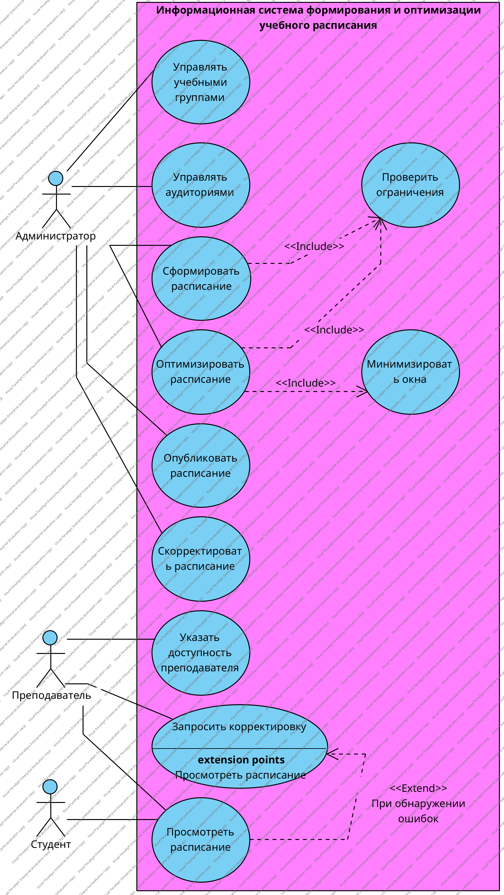

# Visual Paradigm

Visual Paradigm — CASE-среда для связанных моделей информационной системы. В проекте хранятся не только фигуры на листе, но и элементы модели, и один элемент можно показать на нескольких диаграммах. Для «Учебного расписания» этим закрываются диаграммы прецедентов, классов, последовательности, деятельности, состояний, компонентов и развёртывания, а также ERD. Рассмотрены описание продукта и построенная диаграмма.

## Возможности

- В среде есть структурные и поведенческие диаграммы UML, которые нужны следующей работе.
- Элемент предметной области заводится один раз и переиспользуется, без ручного копирования между листами.
- У связей есть типы UML, стереотипы и проверка модели.
- В редакциях Standard и выше доступны генерация и обратное проектирование кода Java, C++ и C#.
- В платных редакциях есть обмен XMI/UML2, если модель нужно перенести в другую CASE-среду.
- Диаграмму можно выгрузить в PNG, SVG, JPG и PDF.
- Кроме UML доступны ERD. BPMN и DFD есть в платных редакциях.
- Настольное приложение работает в Windows, Linux и macOS. Для некоммерческой работы есть бесплатная Community Edition.

## Ограничения

- Интерфейс плотный: много режимов и свойств, на первое знакомство уходит время.
- Community Edition ставит водяной знак на экспорт рисунков и документов. На построенной диаграмме знак присутствует.
- Генерация и синхронизация кода, а также XMI, в Community Edition закрыты.
- BPMN, DFD и расширенные отчёты зависят от редакции.
- Проект хранится в файле .vpp. Построчное сравнение в git для такого файла неудобно.
- Программу нужно устанавливать. Производитель указывает от 4 ГБ оперативной памяти и около 4 ГБ на диске.

## Диаграмма

Диаграмма вариантов использования построена в Visual Paradigm. На ней администратор, преподаватель и студент, прецеденты расписания, отношения include и extend и рамка системы. Подписи include и extend выставлены средствами UML-элементов среды.

## Протокол

Подпись: Протокол построения в Visual Paradigm Community Edition

| Поле | Значение |
| --- | --- |
| Участник | — |
| Инструмент | Visual Paradigm Community Edition |
| Предыдущий опыт | В проекте ранее не применялся |
| Дата | Ноябрь 2026 |
| Время освоения, мин | — |
| Время построения, мин | — |
| Диаграмма достроена | Да. Три актёра, прецеденты расписания, include, extend и рамка системы |
| Обращения к справке | — |
| Трудности | Интерфейс плотный. На экспорте Community Edition стоит водяной знак |
| Оценка по критерию 4 | 3. Диаграмма достроена, на первое знакомство уходит время |
| Оценка по критерию 5 | 4. Include и extend выставлены элементами UML, рисунок читается |
| Комментарий | Элемент модели переиспользуется. Водяной знак учтён в критерии 6, не в этой оценке |
