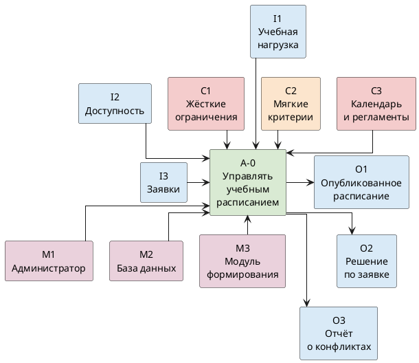

# Контекстная диаграмма IDEF0 A-0

Функция системы — управлять учебным расписанием. Буква задаёт роль дуги: I — вход, C — управление, O — выход, M — механизм. Цвет повторяет роль: голубой — вход и выход, красный — жёсткое управление, персиковый — мягкий критерий, розовый — механизм, зелёный — функция.

## Диаграмма

