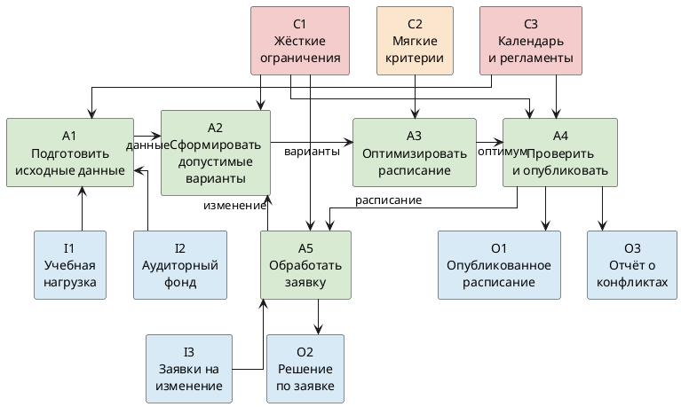

# Декомпозиция IDEF0 A0

A1 готовит данные, A2 отбирает допустимые варианты, A3 оптимизирует, A4 публикует, A5 обрабатывает заявку. Одобренное изменение возвращается в A2.

Жёсткие ограничения: нет двойной занятости преподавателя, группы и аудитории, аудитория подходит занятию. Мягкие критерии: меньше окон, ровнее нагрузка, рациональнее аудиторный фонд.

## Диаграмма

